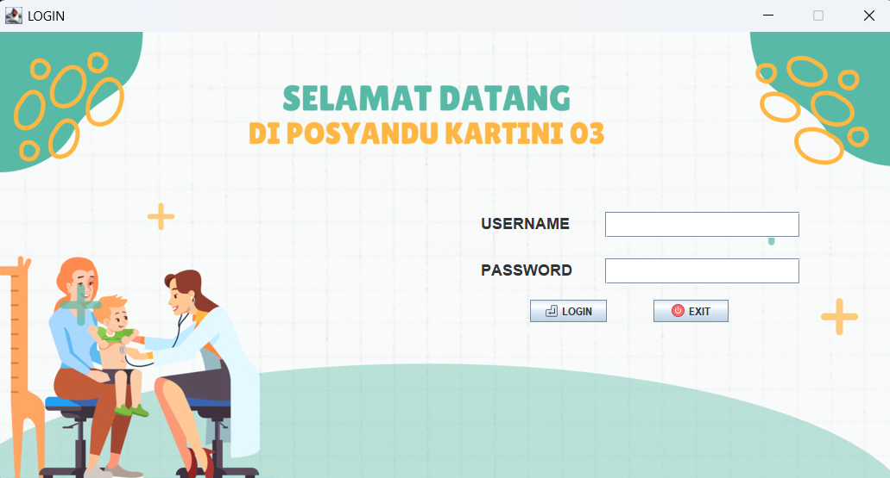
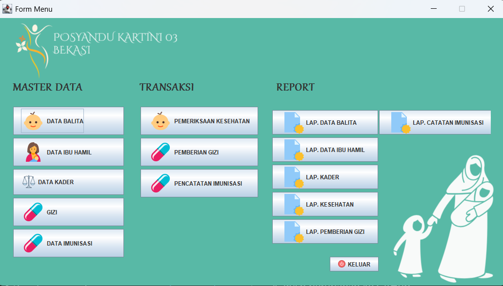
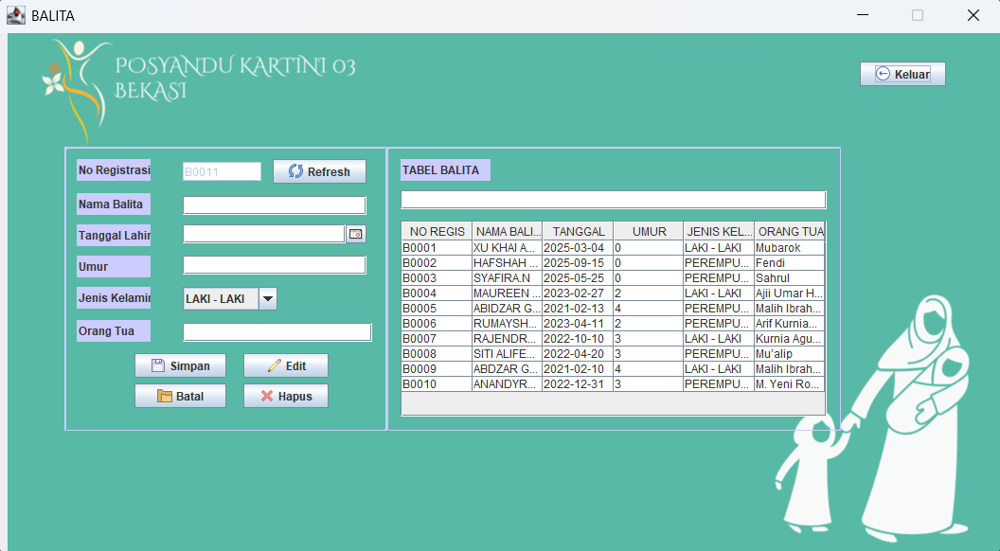
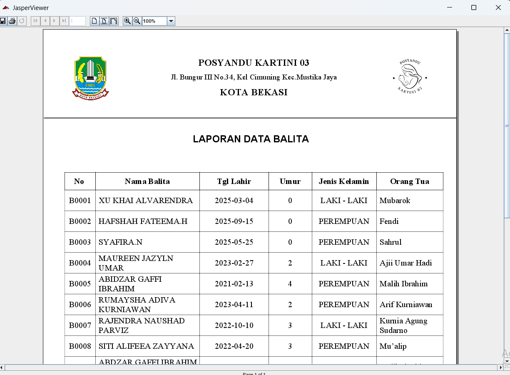

# Aplikasi Posyandu

Aplikasi desktop berbasis Java untuk membantu pengelolaan data dan administrasi Posyandu.

## Teknologi
- Java
- Java Swing
- NetBeans IDE
- MySQL
- XAMPP
- JasperReports
- MySQL Connector/J

## Fitur Aplikasi
- Login pengguna
- Pengelolaan data kader
- Pengelolaan data ibu
- Pengelolaan data balita
- Pencatatan pemeriksaan ibu dan balita
- Pengelolaan data gizi
- Pencatatan imunisasi
- Pembuatan dan pencetakan laporan

## Screenshot Aplikasi

<table>
  <tr>
    <td align="center">
      <b>Login</b><br>
      
    </td>
    <td align="center">
      <b>Main Menu</b><br>
      
    </td>
  </tr>
  <tr>
    <td align="center">
      <b>Data Balita</b><br>
      
    </td>
    <td align="center">
      <b>Laporan Balita</b><br>
      
    </td>
  </tr>
</table>

## Persyaratan
- Windows
- JDK 8 atau lebih baru
- NetBeans IDE 8.2 (untuk membuka dan mengembangkan source code)
- XAMPP dengan MySQL

## Instalasi Database

1. Jalankan Apache dan MySQL melalui XAMPP.
2. Buka phpMyAdmin melalui `http://localhost/phpmyadmin`.
3. Buat database bernama `posyandu`, jika belum tersedia.
4. Pilih database tersebut.
5. Buka menu Import.
6. Pilih file `posyandu.sql`.
7. Klik Import untuk memasukkan struktur tabel dan data dummy.

## Menjalankan Source Code

1. Clone atau download repository ini.
2. Buka NetBeans IDE.
3. Pilih File → Open Project.
4. Pilih folder proyek `posyandu`.
5. Pastikan MySQL sudah aktif dan database berhasil diimpor.
6. Jalankan proyek melalui NetBeans.

## Menjalankan Aplikasi (JAR)

Jika menggunakan paket aplikasi pada GitHub Releases:

1. Ekstrak file ZIP aplikasi.
2. Pastikan file `posyandu.jar` dan folder `lib` berada dalam direktori yang sama.
3. Pastikan MySQL XAMPP aktif.
4. Jalankan aplikasi dengan perintah:

```bash
java -jar posyandu.jar
```

## Konfigurasi Database

Konfigurasi koneksi database terdapat pada:

`src/Connect/Connect.java`

Konfigurasi bawaan:

- Host: `localhost`
- Port: `3306`
- Database: `posyandu`
- Username: `root`
- Password: kosong

Sesuaikan konfigurasi apabila pengaturan MySQL berbeda.

## Catatan

Database yang disertakan merupakan data dummy untuk keperluan pengujian dan demonstrasi aplikasi.

## Pengembang

Muhammad Bintang Syakhila
